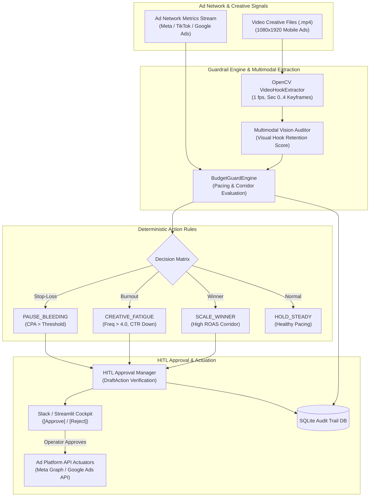
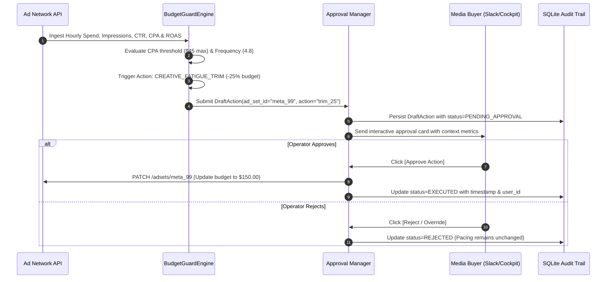

# 🛡️ Ad Campaign Budget Guard (`ad-campaign-budget-guard`)

[](https://www.python.org/)
[](https://opencv.org/)
[](https://streamlit.io/)
[](LICENSE)
[](https://github.com/astral-sh/ruff)

An automated **performance marketing ROAS/CPA guardrail and pacing engine** featuring **root-cause creative fatigue diagnosis** (rising frequency + dropping CTR), **OpenCV video hook keyframe extraction** (1 fps, first 5 seconds), and **Human-in-the-Loop (HITL) approval workflows** for high-risk marketing actions.

---

## 🎯 Target Industries & Production Use Cases

- **Performance Marketing Agencies & Media Buyers**: Managing dozens of client ad sets across Meta Ads, TikTok Ads, and Google Ads who need deterministic stop-loss rules to prevent budget bleed without rogue autonomous API blunders.
- **D2C E-Commerce Growth Teams**: Continuously auditing video hook performance, scaling high-ROAS winner ad sets safely, and routing destructive budget changes through human review channels.
- **Enterprise Ad Spend Optimization**: Enforcing strict governance over daily pacing corridors, avoiding end-of-month budget spikes, and preventing runaway costs on broken landing pages.

---

## ✨ Key Features & Architectural Capabilities

- **Causality-Grounded Creative Fatigue Detection**:
  - Distinguishes between normal traffic variance and audience burnout by evaluating the correlation between **rising ad frequency (> 4.0)** and **dropping CTR**.
- **Multimodal Video Hook Keyframe Extractor (`video_hook_extractor.py`)**:
  - Leverages OpenCV (`cv2`) to extract **1 frame per second** for the **first 5 seconds** (the critical viewer retention window).
  - Emits clean Base64 JPEG data URIs formatted for Vision LLM auditing without GPU memory exhaustion.
- **Deterministic 4-Tier Guardrail Engine (`engine.py`)**:
  - `PAUSE_BLEEDING` (Stop-Loss): Immediately halts ad sets exceeding spend thresholds with zero conversions or unacceptable CPA.
  - `CREATIVE_FATIGUE_TRIM`: Decreases budget by 25% when audience saturation is detected.
  - `SCALE_WINNER`: Boosts daily budget (+20%) when ROAS and conversion metrics stay inside target corridors.
  - `HOLD_STEADY`: Preserves existing budget allocation.
- **Human-in-the-Loop (HITL) Safety Gate (`hitl.py`)**:
  - All high-risk destructive actions (`pause_ad_set`, `adjust_budget`) generate `DraftAction` proposals requiring explicit sign-off via Slack or dashboard cards.
  - Low-risk non-destructive tasks (e.g. `generate_ad_copy`) run autonomously.

---

## 🏗 System Architecture



---

## 🔄 Guardrail & Approval Flow



---

## 🚀 Quick Start & CLI Usage

### 1. Installation

```bash
cd ad-campaign-budget-guard
pip install -r requirements.txt
pip install -e .
```

### 2. Run CLI Benchmark & Exporters

```bash
# Execute evaluation demo across sample campaigns
python -m ad_campaign_budget_guard.cli --demo --out-csv data/decisions.csv --out-json data/summary.json
```

### 3. Launch Streamlit Operations Cockpit

```bash
streamlit run src/ad_campaign_budget_guard/dashboard.py
```

### 4. Run Automated Tests

```bash
pytest tests/ -v
ruff check .
```


---

## 🖼️ User Interface & Anomaly Alerting Preview

*Visual audit cockpit and instant Telegram emergency alert preview.*

```
+------------------------------------------------------------------------------------+
|  AD CAMPAIGN BUDGET GUARD -- AUDIT & EMERGENCY DISPATCH COCKPIT                    |
+------------------------------------------------------------------------------------+
|  Status: ACTIVE RUNNING  |  Monitored Accounts: 12  |  Burn Spike Guard: ON (3.0x) |
+------------------------------------------------------------------------------------+
|  Campaign ID        | Platform  | Spend / Hr  | Target CPA | Anomaly Status       |
|  cmp_retarget_fb_01 | Meta Ads  | $142.50/hr  | $14.20     | CRITICAL SPEND SPIKE |
|  cmp_brand_search   | Google    | $28.10/hr   | $8.50      | NORMAL (P95 Latency) |
+------------------------------------------------------------------------------------+
|  [ Emergency Killswitch: ENGAGED ]  [ Telegram Dispatch Sent: 2026-11-09 20:45 ]  |
+------------------------------------------------------------------------------------+
```

*(Visual UI screenshots and system workflow previews will be linked here from the `/screenshots` folder).*

---

## 💼 Commercial Licensing & Deployment

This production system is engineered and maintained by **Nataliia Zyma**.

The core engine is enterprise proprietary software available for **commercial licensing**, **custom enterprise integration**, or **turnkey business deployment**:
- **Direct Email:** [`zymaneta@gmail.com`](mailto:zymaneta@gmail.com)
- **GitHub:** [@zymaneta-eng](https://github.com/zymaneta-eng)
- **Turnkey Integration:** Full custom setup, integration with existing company infrastructure, ad accounts, and SLA monitoring within 48–72 hours.
- **SLA & Response:** Enterprise inquiries are reviewed and answered within 2–4 business hours.
